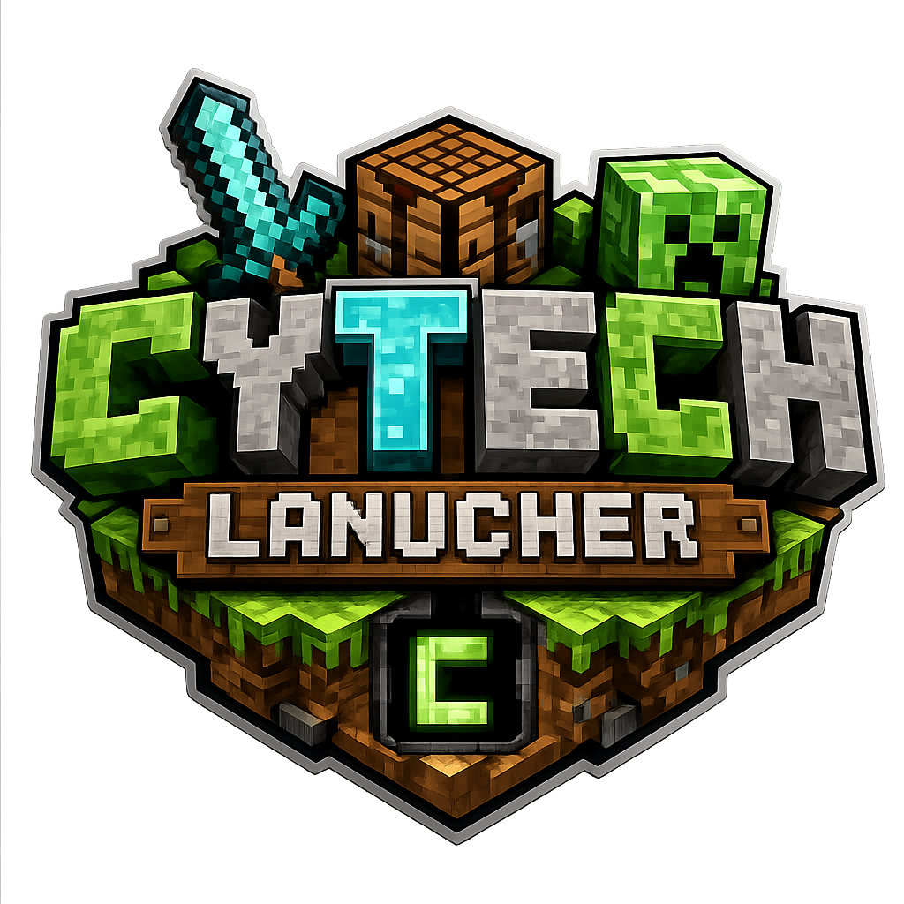

<!-- CYTECH_README_REFRESH:START -->

 

<a href="https://github.com/CyoriaSMP-Team/CyoriaLauncher">Source</a> · <a href="https://github.com/CyoriaSMP-Team/CyoriaLauncher/issues">Issues</a> · <a href="https://github.com/CyoriaSMP-Team/CyoriaLauncher/releases">Releases</a>

<!-- CYTECH_README_REFRESH:END -->

---

Unified launcher workspace for **Desktop** and **Mobile**.

## Structure

- `desktop/` — desktop launcher application
- `mobile/` — Android/mobile launcher application
- `shared/` — shared sync schemas, protocol definitions, account metadata and cross-platform configuration

## Direction

CyoriaLauncher is the common home for both launcher clients so features such as account/session metadata, launcher settings, instance metadata and future cloud sync can share one versioned contract instead of drifting between separate repositories.

The two applications remain independently buildable. Cross-platform functionality should be introduced through `shared/` and explicit sync APIs rather than tightly coupling the desktop and mobile runtimes.

## Migration

This repository was created from current snapshots of the former launcher repositories. See [MIGRATION.md](MIGRATION.md) for source history and attribution.

---

<!-- CYTECH_STAR_HISTORY:START -->

## Star History

<a href="https://star-history.dera.page/#CyoriaSMP-Team/CyoriaLauncher&type=date&legend=top-left">
  <picture>
    <source media="(prefers-color-scheme: dark)" srcset="https://star-history.dera.page/svg?repos=CyoriaSMP-Team/CyoriaLauncher&type=date&legend=top-left&theme=dark" />
    <source media="(prefers-color-scheme: light)" srcset="https://star-history.dera.page/svg?repos=CyoriaSMP-Team/CyoriaLauncher&type=date&legend=top-left" />
    
  </picture>
</a>

<!-- CYTECH_STAR_HISTORY:END -->
